# Scattered Notes Harness for ADHD Mind

By Weng (Weng Fei Fung)

For ADHD minds that jot notes everywhere in real time-and wishes to turn the mess into clear tasks and reference.


[](https://github.com/Siphon880gh)
[](https://www.linkedin.com/in/weng-fung/)
[](https://www.youtube.com/@WayneTeachesCode/)

A Cursor / Claude Code harness for turning a folder of ad-hoc notes into grouped tasks and reference knowledge—without losing detail.

The PHP app is an **artifact container**. The skill does the heavy organizing in Cursor or Claude Code and writes artifacts next to your notes. You open `index.php` to review them, make light Phase 2 adjustments in the browser (move / tag / reorder / Suggest / green-check — saved into `phase2.json` or `phase2-suggestions.md`), then return to the chat for merges, fidelity fixes, or to lock Phase 3. Phase 2 already puts area tags on each card and in the Filter bar. Phase 3 locks review controls and is mainly **filter + Copy** into your permanent notes app.

The newer version is packed with more ways to organize your scattered ideas: colored note regions, a map of the whole file, Split and Merge when a boundary is wrong, and a Projects menu so folders such as `inputs/sort-scattered` and `inputs/sample` stay separate.

## Why this exists for ADHD

If you have ADHD, notes rarely land in one place. You jot something in a `.txt` file, sketch an idea in a `.md` note, save a half-formed thought in another file—and weeks later you have a folder of fragments with no clear through-line.

This harness is for that chaotic, on-the-fly jotting of a fast ADHD brain: dump first, then let AI sort it into something usable—**actionable** tasks or **referable** knowledge.

It does not matter if notes on the same subject are split across different files, if each line is a different idea, or if a whole document is broken up with empty lines. Dividers are fine: dashes (`--`, `---`, `------`), `<hr>`, a line of asterisks, or two blank lines in a row. One blank line is paragraph space. The app draws each divider as a candidate note, and the skill decides whether it starts a new idea or is only a section of the same article. You can paste an entire article next to other thoughts and mark it off with a divider; internal rules in that article stay part of it when they are sections, not new ideas. If a region is still wrong, redraw it in Phase 1 (Split, or Merge up / Merge down). Delete removes an idea from every phase; the original file stays, and Restore in Phase 1 brings it back. That correction is saved and the skill follows it.

Shorthands and symbols are welcome too. When something is unclear, AI asks you to clarify, then builds a dictionary of your shorthands (`shorthands.md`) so it can read your notes the way you write them.

See also: [README-Tips-How your scattered notes should be.md](README-Tips-How%20your%20scattered%20notes%20should%20be.md)

## Roles

| Piece | Role |
|-------|------|
| `.agents/skills/scattered-notes` | Agent skill: pick folder, write artifacts, update config |
| `app.config.json` | Points the app at one `inputs/` folder and the active phase |
| `index.php` | Phase 1 reviewer + Phase 2/3 interactive organizer (saves into `phase2.json`) |

Each folder under `inputs/` is a separate project. Use **Projects** in the app header to switch (for example `inputs/sort-scattered` and `inputs/sample`). That writes `app.config.json` and restores the phase that project was last on. Snapshots stay available from either project. The skill can also point the file at a folder.

## Setup

1. Create a batch folder: `inputs/whatname/`
2. Drop scattered notes as `.md` and/or `.txt`. One thought per file, many thoughts in one file, or one thought split across files—all fine. A divider (`---`, `<hr>`, `***`, or two blank lines) marks a possible new idea; the skill decides whether it is a new idea or a section of the same article. A single blank line is the candidate only when the file has no divider.
3. A photo can live in that same folder. Link it with markdown `` or Obsidian `![[photo.png]]`. To have images downloaded for you, skip the files and paste a public note URL instead (next section).
4. In Cursor or Claude Code, run the skill at `.agents/skills/scattered-notes` and pick that folder (the skill will set `app.config.json`) — **or** prompt to use the scattered note organizing skill.
5. Serve the app and open it to review artifacts:

```bash
php -S localhost:8765
```

Then open `http://localhost:8765`.

Photos in a note show at a size that fits the page and keep their shape. Click a photo to open a larger view, then **Enlarge** if you want it bigger.

## Public Evernote or UpNote link

Instead of copying files in, make the note public in the app and paste the https URL in the skill chat.

- **Evernote.** Open the note, choose Share, set **Anyone with the link can view**, and copy the link (`https://share.evernote.com/note/...`, or an older `evernote.com/shard/...` public link).
- **UpNote.** Open the note, choose Share, then **Copy Link** on desktop or **Share Link** on a phone. An `upnote://` link only opens the app. Use the https link.

The skill saves the note under `inputs/{name}/`, downloads each image into `attachments/`, and links it with ``. You do not place the image files yourself.

## Input layout

```
shorthands.md          # app-wide glossary (skill-maintained)
app.config.json
inputs/
  whatname/
    note-one.md
    random-thought.txt
    photo.png                    # optional; linked as  or ![[photo.png]]
    attachments/                 # images downloaded from a public Evernote or UpNote note
    phase1.json              # uncertain marks + YouTube descriptors
    phase1-suggestions.md    # optional: shorthand, enrichment, whole-idea, and per-line Suggest notes
    phase1-regions.md        # optional: your Split / Merge corrections to note boundaries
    phase2.json              # organized notes + blame map + tags (Phase 2/3)
    phase2-suggestions.md    # optional: your Suggest notes for the next Phase 2 pass
```

`app.config.json`:

```json
{
  "inputFolder": "whatname",
  "phase": 1,
  "projects": {
    "whatname": { "phase": 1 },
    "sample": { "phase": 3 }
  }
}
```

`phase` may be `1`, `2`, or `3`. It is the phase of `inputFolder`. `projects` remembers the phase of every other folder so switching projects does not reset them. When you change `app.config.json`, keep `projects` and set `projects[inputFolder].phase` to the phase you are writing.

## Three phases

### Phase 1 — review marks, links, and boundaries

The skill reads the app-wide `shorthands.md` (project root) first, then marks unclear symbols and shorthand. YouTube links get a green “added” descriptor (title / what the video is about) inferred from the video’s title, description, and comments—no watching required.

Review marks in `index.php`. Explain shorthand in the agent chat; the skill updates root `shorthands.md` and refreshes `phase1.json`. Reload the app to see updates.

The same screen numbers each distinct note and shows the whole file on a map at the right. A divider (`---`, `<hr>`, `***`, or two blank lines) starts a candidate note; the skill decides whether that is a new idea or a section of the same article. A file with no divider is split on single blank lines. Neighboring notes never share a color.

If the AI’s boundary is wrong:

- **Split** — then choose the line where the second idea starts
- **Merge up** or **Merge down** — those notes are one idea
- **Delete** — that idea leaves every phase. Undo on the page brings it back. After a reload, **Restore** under Deleted puts it back in Phase 1. Phase 2 and Phase 3 have **Delete** on each card, and in Notebook. Deleting a snapshot card removes it from that snapshot only.

Colors are reassigned automatically. The edit is saved to `phase1-regions.md`. The skill reads that file before it groups notes and does not throw the correction away. Putting the boundary back removes the saved edit.

### Phase 2 — sort notes and review tags

When Phase 1 is done, the skill groups notes into **Scattered**, **Reference**, and **Articles** (stored in `phase2.json` as `tasks`, `reference`, and `articleCandidates`). Every card is written for you to read later: a short heading (added when the note had none) and a sentence or short paragraph that says what the idea is, then your original lines. Every source line is accounted for in a blame map so details do not disappear silently.

Visit the web app and check that things are properly organized. In the app you can:

- **Move** items between Scattered / Reference / Articles (Move dropdown on each card)
- **Green-check** items as you review them (circle next to the title; saved into `phase2.json`)
- **Suggest** on any card (and on each section header: Scattered / Reference / Articles) — tell the AI how to change a note or a whole section (rewrite, merge, move, tagging, heading style, ordering); saved to `phase2-suggestions.md` for the next pass
- **Tags** are already on each card and in the **Filter** bar. Add, remove, or rename one on the right if it is wrong.
- **Collapse / expand** each panel from its header
- **Rearrange** items inside a panel: click the ↔ icon, drag cards, then release (or click ↔ again) to finish — order is saved
- Open original notes with per-line accounting via the hamburger (**B** toggles that sidebar open/closed)

Panel moves/tags POST to `index.php?action=save-phase2` (`phase2.json`). Suggest notes POST to `index.php?action=save-suggestions` (`phase2-suggestions.md`). Return to chat for merges, fidelity fixes, or to start Phase 3 — the skill reads your suggestions when revising Phase 2.

### Phase 3 — filter and copy into your notes

Phase 2 already tags every card by area and writes a `filterLayout` that groups related tags with dividers between major areas. Tags can chunk up/down an idea (supercategory / category / subcategory); an item may have more than one tag. Spaces in tags are fine; prefer short phrases over long ones.

When Phase 2 looks good, the skill applies any pending `phase2-suggestions.md` notes, re-reads `phase2.json` (including browser edits), keeps the tags you already set, and only fills an item that is still untagged. User-added tags are preserved and merged.

Refresh the app: **Suggest** and green-check are off. Filter by tag and **Copy** cards (or whole panels) into your permanent notes app. Tag/move tweaks still save; return to chat only if you need tag refinements.

## Skill handoff

Each phase in the app tells you how to return to Cursor or Claude Code to continue. Typical loop:

1. Skill writes artifacts and sets `app.config.json`
2. You review in `index.php`
3. You go back to the chat to explain marks, advance phases, or fix fidelity gaps

## Alternate workflow (slash commands)

Same harness, stepped explicitly in chat:

1. `/scattered-notes Start` — list folders under `inputs/`, pick one (or reset sample / use your own notes)
2. `/scattered-notes Lets start Phase 1` — mark uncertain shorthand/symbols and enrich YouTube links; review in `index.php`, then return to chat to explain marks or confirm
3. `/scattered-notes Lets go to Phase 2` — organize into Scattered / Reference / Articles with per-line blame; review and lightly edit in `index.php`, then return to chat to refine or advance
4. `/scattered-notes Lets go to Phase 3` — apply pending suggestions if any, keep the Phase 2 tags, fill any that are still missing; in `index.php` filter + Copy into your notes app (Suggest / check locked)

Between steps, serve and open the app as usual (`php -S localhost:8765` → `http://localhost:8765`).

## Who this is for

Anyone who captures thoughts in bursts and organizes later—or never quite gets to the organizing part. Messy files, personal shorthand, split subjects, and divider chaos are expected. The harness meets you where your notes already are and turns them into something you can act on or look up.

## How it looks / how to use

### Phase 1 — distinct ideas, and a map of the whole file

Open a batch in the app and each note is its own colored region, numbered with the source line range. Here `inputs/sort-scattered` is 54 notes, drawn from divider lines such as `---`. The skill then decides which of those are a new idea and which are a section of the same article. The counts along the top — Files, Uncertain, YouTube, Links, Blocked — open a list; click a row and the page jumps to that line. The strip on the right is the whole file, one band per note, so a long dump stays visible at once. Click the colored edge to suggest a change for that whole idea, or click a line to suggest a change for that line’s text; both are saved for the next phase. **Suggest** also sits on a shorthand flag and on a green YouTube or link line.

If the boundary is wrong, **Split** a region that is really two ideas, or **Merge up** / **Merge down** when two regions are the same idea. **Delete** removes an idea you do not want; **Restore** brings it back in Phase 1. Colors are reassigned so two notes in a row never share one. **Projects** in the header switches to another folder and restores that project’s phase. Snapshots, saved from Phase 3, stay available from either project.

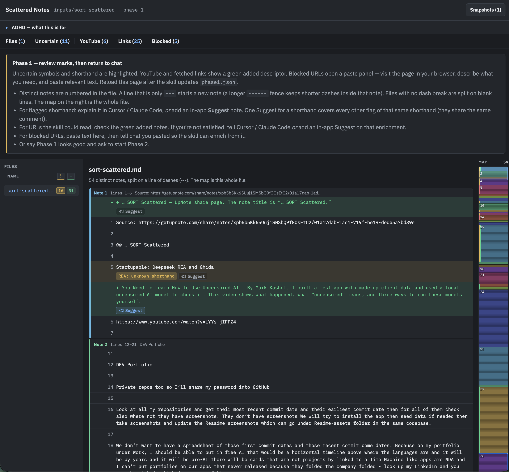

### 1. Run the skill and pick a folder

In Cursor or Claude Code, ask to use the scattered-notes skill. The agent lists folders under `inputs/` and waits for you to pick one (here: `sample`).

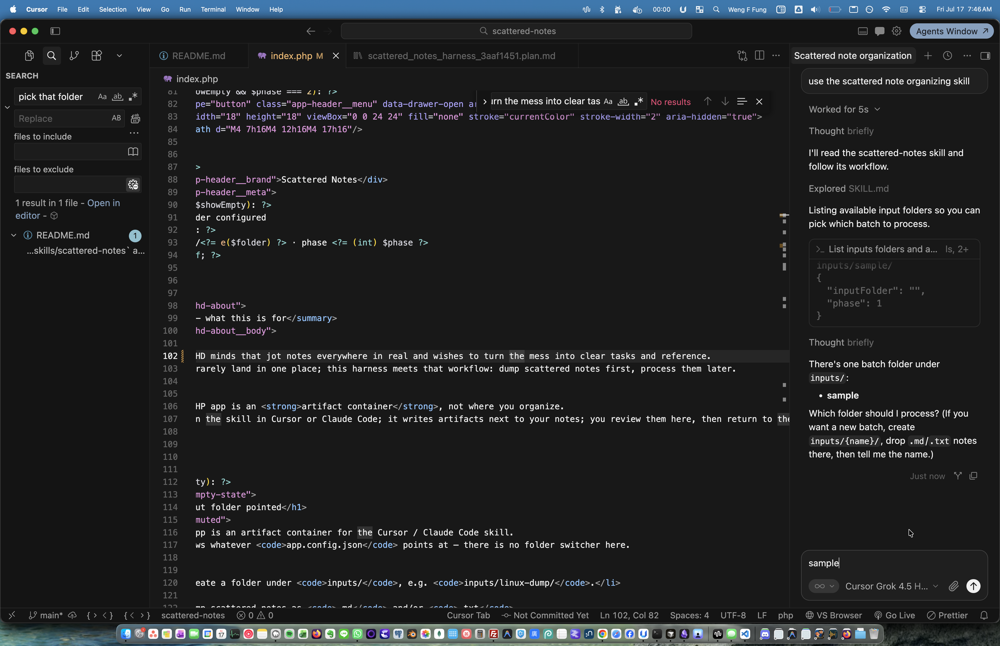

### 2. Phase 1 artifacts land in the batch folder

The skill writes `phase1.json` (uncertain marks, YouTube descriptors) and points you at the PHP app to review—or you can tell it Phase 1 looks good and to continue.

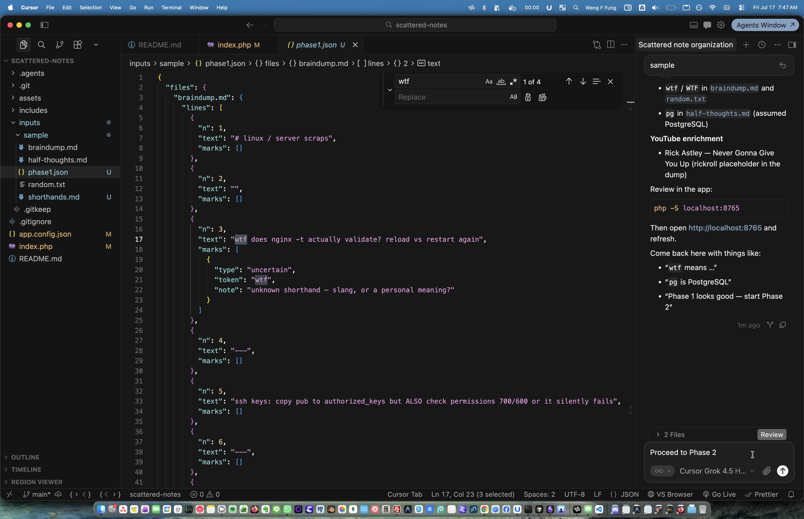

### 3. Review Phase 1 in the app — uncertain marks and YouTube adds

Open `index.php`. Uncertain shorthand is highlighted with a note; YouTube links get a green added descriptor. Explain marks back in chat, or say Phase 1 looks good.

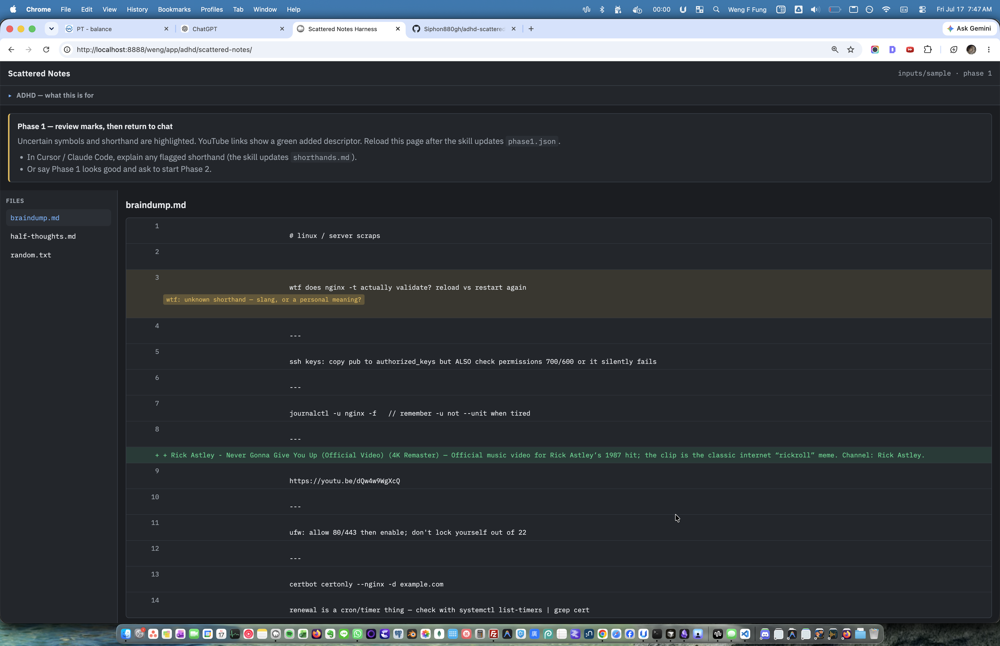

### 4. Flip through files — more shorthand marks

Same Phase 1 view on another note (`half-thoughts.md`): e.g. `pg` flagged for confirmation.

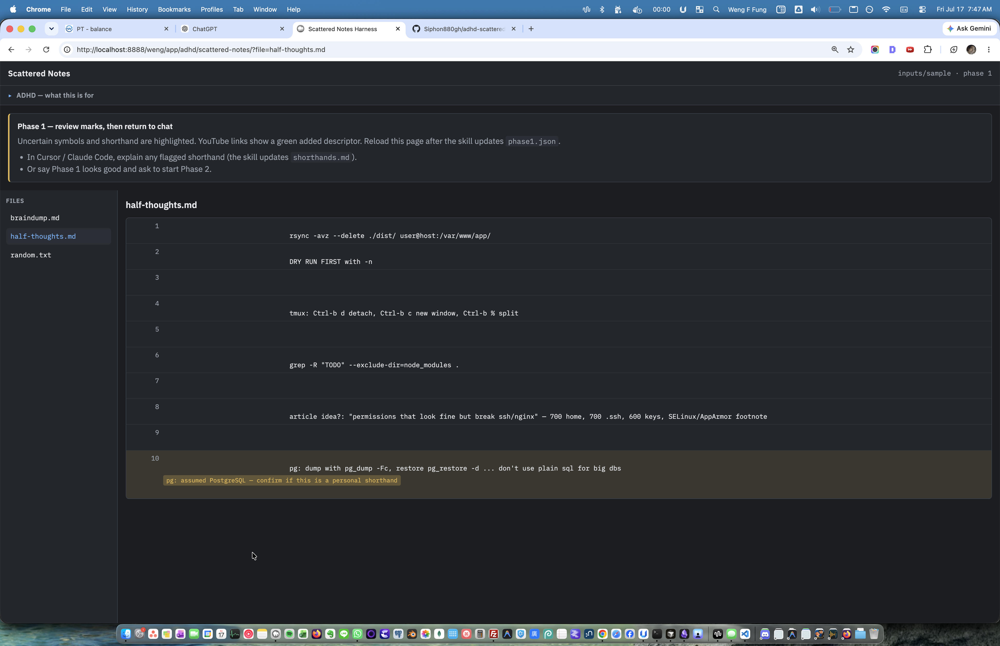

### 5. Cross-file marks

Marks can repeat across files (e.g. `WTF` in `random.txt` linked to the same token in `braindump.md`).

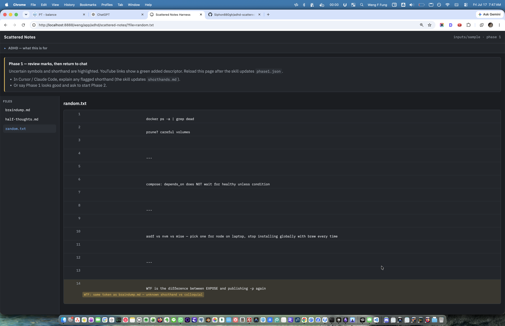

### 6. Advance to Phase 2 in chat

Back in the agent chat, ask to proceed to Phase 2. The skill writes `phase2.json` and sets `app.config.json` to phase 2.

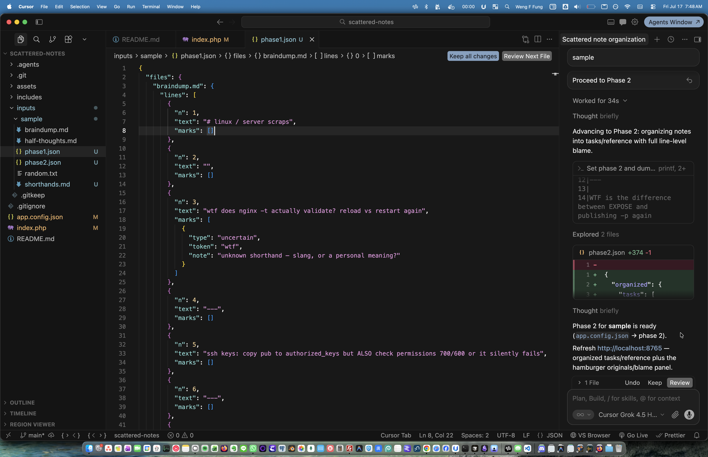

### 7. Phase 2 — organized panels you can edit

Reload the app. The main view shows **Scattered**, **Reference**, and **Articles** with source line links. Each card already has area tags, and the same tags are the Filter chips at the top. Use the right-side tray to add, remove, or rename a tag, and Move between panels. Collapse panels from the header; use ↔ to rearrange within a panel.

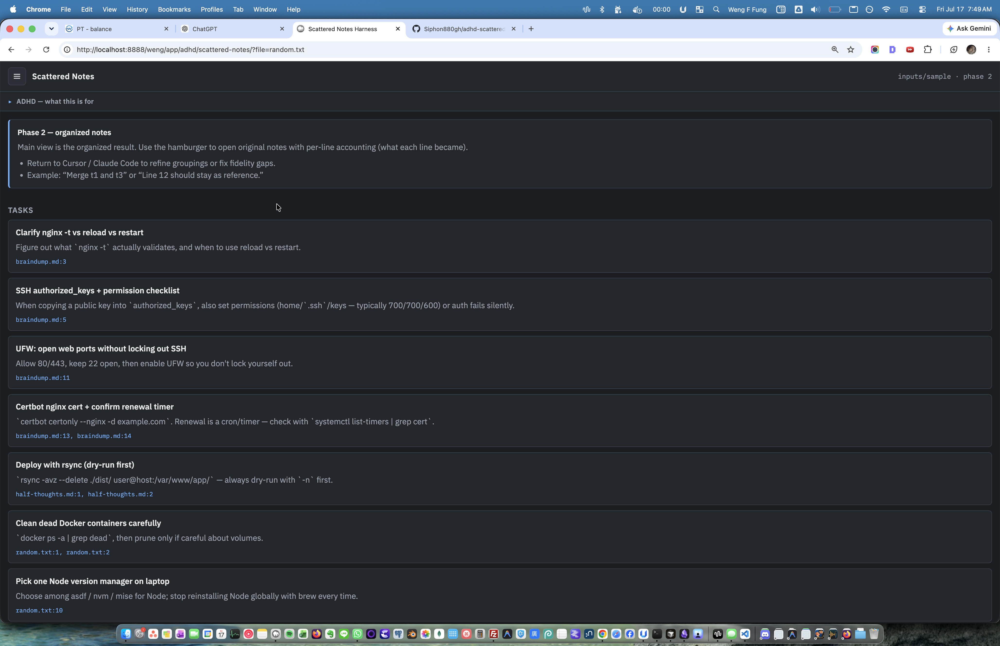

### 8. Hamburger — original notes with per-line accounting

Use the hamburger (or **B**) to open or close original notes. Each source line shows what it became (`mapped`, `merged`, `reference`, `dropped_noise`, etc.) so nothing disappears silently.

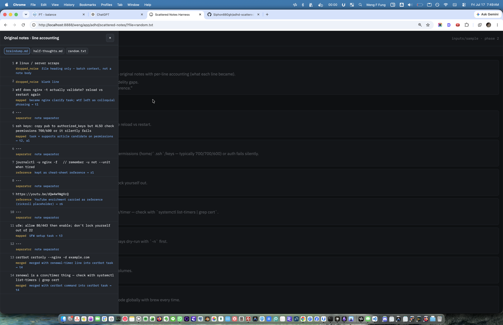

### 9. Phase 2 — suggest at the group level

On a section header (Scattered / Reference / Articles), click **Suggest** and tell the AI how to change every note in that group—for example, heading style, ordering, or tagging. The note is saved to `phase2-suggestions.md` for the next pass.

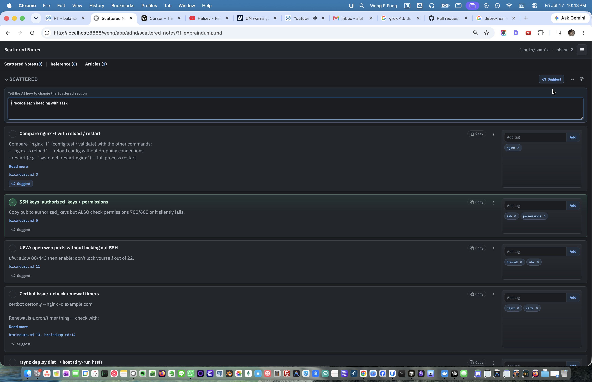

### 10. Phase 3 — group instructions applied

After you advance, those section-level instructions are applied across the whole group. Here, “Precede each heading with Task:” rewrote every Scattered heading; Phase 3 then locks Suggest and green-check so you can filter and Copy into your notes app.

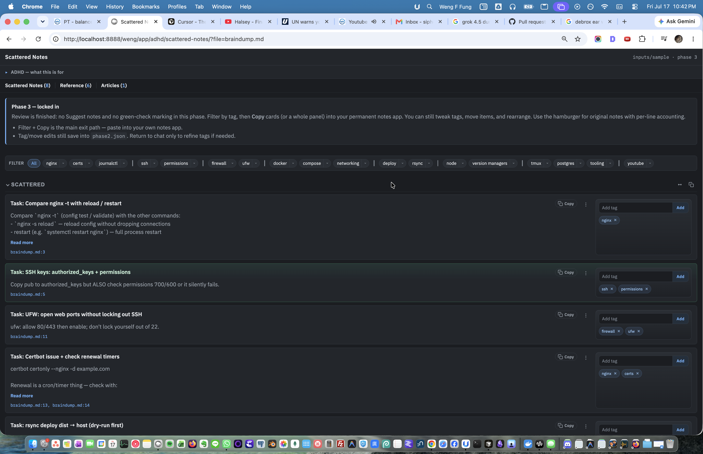
